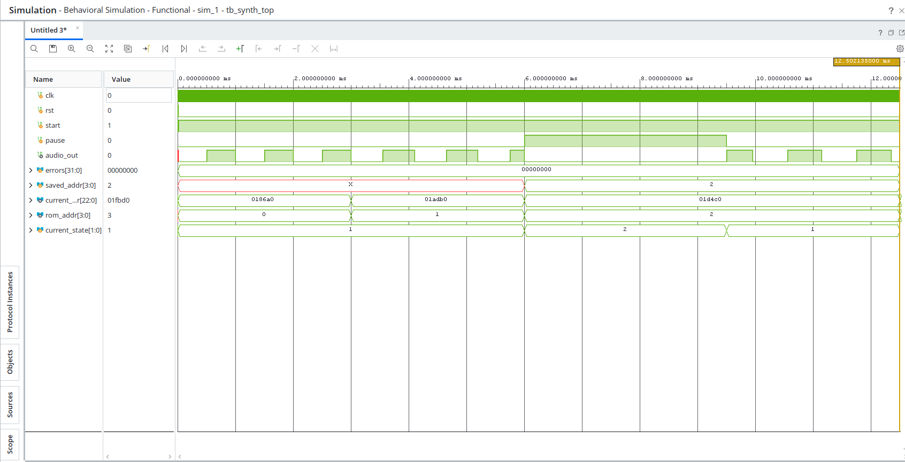

# Verilog SoC Digital Audio Synthesizer & Sequencer

A hierarchical, modular digital audio synthesizer and 16-step hardware sequencer written in Verilog HDL and verified in Xilinx Vivado.

## Architecture Overview
The design is structured as a scalable System-on-Chip (SoC) IP block driven by a 100 MHz system clock:

1. **`sequencer.v` (3-State FSM & Tempo Generator):** Implements an `IDLE` / `PLAY` / `PAUSE` Finite State Machine alongside a parameterized 24-bit BPM clock divider (configured for 120 BPM 16th-note resolution at 100 MHz) to drive the 4-bit step address pointer.
2. **`note_rom.v` (Synchronous Pattern Memory):** A 16-step synchronous lookup table storing 23-bit frequency divisors, structured for Block RAM (BRAM) inference.
3. **`tonegen.v` (Parametric Frequency Divider):** A 23-bit digital frequency divider generating 50% duty-cycle square-wave audio outputs with zero-divisor rest handling.
4. **`synth_top.v` (Top-Level SoC Wrapper):** Integrates the sequencer, ROM, and tone generator with synchronous output mute gating during `IDLE`, `PAUSE`, and musical rests.

## Verification & Simulation
Verified using a self-checking testbench (`tb_synth.v`) in Xilinx Vivado XSim validating synchronous reset, `IDLE` silence, step-by-step frequency modulation, mid-sequence `PAUSE` state retention, and seamless playback resume with 0 errors.

## How to Run in Vivado
1. Add `tonegen.v`, `note_rom.v`, `sequencer.v`, and `synth_top.v` under **Design Sources** (set `synth_top` as Top).
2. Add `tb_synth.v` under **Simulation Sources**.
3. Click **Run Behavioral Simulation** and execute `run all` in the Tcl Console.
